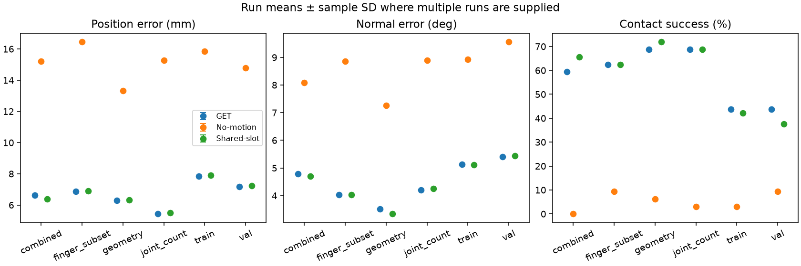

# Sample prediction results

Both models improve substantially over no motion. GET and the shared-slot baseline
are close on this sample; it does not establish a GET advantage.

The evaluator scored Anushka's supplied predictions for 224 examples across seven
LEAP hands. The table below uses only the four test splits: 32 examples from one
hand per split, 128 total. Training and validation rows are excluded.

| Method | Mean contact error | Contact success | Joint-limit violations |
| --- | ---: | ---: | ---: |
| No motion | 15.07 mm | 6/128 (4.7%) | 0/128 |
| GET joint tokens | 6.31 mm | 83/128 (64.8%) | 1/128 |
| Shared-slot baseline | 6.28 mm | 86/128 (67.2%) | 0/128 |

Both models reduce mean error by about 58%. Shared-slot is ahead by 0.035 mm and
three successful examples. With one checkpoint per model and only 32 examples per
test hand, this is a sample check rather than a final ranking. These are all LEAP
variants, so the results do not test transfer to a different hand family.

## Results by split

| Test split | No motion mm / successes | GET mm / successes | Shared-slot mm / successes |
| --- | ---: | ---: | ---: |
| Geometry | 13.33 / 2 | 6.30 / 22 | 6.31 / 23 |
| Joint count | 15.26 / 1 | 5.43 / 22 | 5.51 / 22 |
| Finger subset | 16.45 / 3 | 6.87 / 20 | 6.90 / 20 |
| Combined | 15.23 / 0 | 6.64 / 19 | 6.38 / 21 |

Each success count is out of 32. On validation, GET has 7.17 mm error and 14/32
successes; shared-slot has 7.24 mm and 12/32. Training rows are in-sample.

Lower is better for position and normal errors; higher is better for success.
The plot also includes train and validation. There is one run per model, so no
seed-variation estimate. Shared-slot changes joint representation as well as graph
biases; this comparison does not isolate the effect of graph attention.

## Scoring and checks

- Contact success requires every requested point within 10 mm and every normal
  within 15 degrees. It does not measure object placement or rollout success.
- Joints are clamped before contact scoring. Limit violations use the raw
  predictions with a 0.001-rad tolerance, matching Anushka's settings.
- GET's one limit violation is finger-subset hand `I0-M0-R2-T2_g0`, row 30,
  joint `9`: 0.003611 rad beyond the upper limit. That example also fails contact success.
- All 3,584 per-example comparisons with the supplied metrics pass. Success and
  limit flags match exactly; maximum numeric differences are 0.0000363 mm and
  0.000832 degrees. The recorded goal reconstructs at effectively zero error.
- No invalid predictions were found. Collision checks are unavailable, so collision
  rate and physically valid success are n/a. Wrist errors were not cross-checked.
- Predicted poses were preserved during import. Row order follows the supplied
  README and is cross-checked with per-row no-motion scores. Checkpoint identifiers
  are producer-supplied; no checkpoint inference or training was rerun.

See [Evaluation](EVALUATION.md) for the commands and file formats. The detailed
local run is under `data/evaluation/leap_predictions_2026-11-19/`, including per-row
results, pose plots, input hashes and `verification.json`. These generated files
and the original archives are not included in Git.

## Next steps

- Agree on the full evaluation splits and main model comparison with the team.
- Score the full predictions and additional training seeds, if available, using
  the same contact thresholds and joint-limit handling.
- Request a matched graph-off run if the question is whether graph attention helps.
- Get the actual checkpoints for Simon's task rollouts, and agree on fixed episodes
  and the success definition before comparing models.
